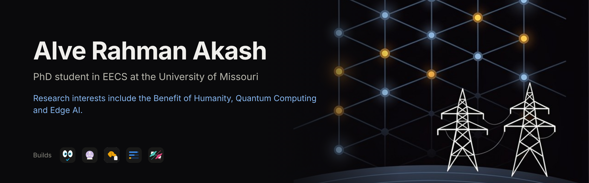
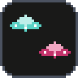
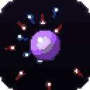
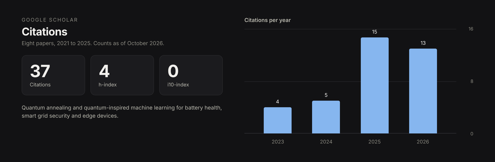

  

# Alve Rahman

I have been working with AI since 2020, but never got the time to create a git for myself, so here I am. The below thread here are some tooling for Claude Code and some fun apps, I built around one habit, since the inception of LLMs: verify what a chat model would otherwise just assert.

## What I build

<table>
<tr>
<td width="88" align="center" valign="middle"></td>
<td valign="middle"><a href="https://github.com/AlveeeRahman/research-hound"><b>research-hound</b></a> A five-stage research workflow for Claude Code, with 21 scripts that check citations and claims instead of trusting the model.</td>
</tr>
<tr>
<td width="88" align="center" valign="middle"></td>
<td valign="middle"><a href="https://github.com/AlveeeRahman/skill-vision"><b>skill-vision</b></a> Validates Claude Agent Skills for spec conformance, quality and security, and counts the context tokens each one costs.</td>
</tr>
<tr>
<td width="88" align="center" valign="middle"></td>
<td valign="middle"><a href="https://github.com/AlveeeRahman/agent-oracle"><b>agent-oracle</b></a> Decides how an agent system should be built before it runs, from the number of agents to what gets locked down.</td>
</tr>
<tr>
<td width="88" align="center" valign="middle"></td>
<td valign="middle"><a href="https://github.com/AlveeeRahman/mr-usage"><b>mr-usage</b></a> A Rust and Tauri desktop app that shows what is left on nine paid APIs, with keys kept in the OS keystore.</td>
</tr>
<tr>
<td width="88" align="center" valign="middle"></td>
<td valign="middle"><a href="https://github.com/AlveeeRahman/llm-dogfight"><b>llm-dogfight</b></a> Two small local language models command rival saucer fleets in your terminal while a genetic algorithm evolves their tactics.</td>
</tr>
<tr>
<td width="88" align="center" valign="middle"></td>
<td valign="middle"><a href="https://github.com/AlveeeRahman/GlassVGL"><b>GlassVGL</b></a> &nbsp;<code>$12.99</code> A frosted-glass theme for LVGL 9 on microcontrollers, with free samples for Arduino, PlatformIO, ESP-IDF and Zephyr. It is built for ESP32, RP2040 and STM32 boards as well as the PC, and one theme scales from a 240x240 round screen to a 1024x600 panel, picking a FULL, LITE or FLAT render mode from the memory on the board. The theme itself is GlassVGL Pro, $12.99 on Gumroad or $11.99 on Ko-fi, not on sale yet.</td>
</tr>
</table>

NVIDIA SkillSpector scans the three skills on every push, and each ships with a `.skillspector-baseline.yaml` that names every suppressed finding and why.

## In the works

Four of my own, still in active development.

<table>
<tr>
<td width="88" align="center" valign="middle"></td>
<td valign="middle"><a href="https://tigerocr.buildforpeople.dev"><b>TigerOCR</b></a> &nbsp;<code>beta</code> Hosted GPU OCR that turns PDFs and images into clean Markdown, as a remote MCP server and REST API.</td>
</tr>
<tr>
<td width="88" align="center" valign="middle"></td>
<td valign="middle"><a href="https://github.com/AlveeeRahman/OpenCarMind"><b>OpenCarMind</b></a> &nbsp;<code>beta</code> A car logger for the ESP32-S3 with a 93 KB on-chip neural network and a desktop app for Windows, macOS and Linux.</td>
</tr>
<tr>
<td width="88" align="center" valign="middle"></td>
<td valign="middle"><b>Murasaki</b> &nbsp;<code>invite only</code> A purple-team platform for authorized security research, with AI-driven reverse engineering and ICS threat modeling.</td>
</tr>
<tr>
<td width="88" align="center" valign="middle"></td>
<td valign="middle"><b>LiteEDA</b> &nbsp;<code>alpha</code> A Rust and Tauri desktop IDE that builds and flashes ESP32 and Arduino firmware and runs the open-source FPGA flow, with an on-device assistant.</td>
</tr>
</table>

## How I work with Claude

  
  
  
  
   
  
  
  
  
  
  

I'm on Claude's Ultra plan, with advanced agent access in Claude Duet. Duet runs as the orchestrator and sends work out to many Claude agents in parallel across my projects.

- 📋 Each agent logs its progress in detail. What reaches me is results, blockers and questions, never status chatter.
- 🔍 No research claim gets trusted until hall-hunter has been over it.
- 🔀 Every change goes in as a pull request and gets reviewed before it merges.
- 🐧 CI stays lean: quick Linux checks on pull requests, full builds only for releases.

I also have Gemini and Perplexity subscriptions. Both are good, but I open them far less, because I think Claude is the best.
 

Outside the tooling, my research is AI and quantum annealing, applied to power systems and power electronics.

My Claude Code sessions run in the cloud with a short rulebook that Claude reads before anything else.

- 🌐 Anything that touches the live web goes through agent-reach: SerpApi answers which pages rank, Firecrawl reads the page, and its developer, research and government indexes handle code, papers and law. The built-in search stays off unless I ask for it, because I want results I can audit.
- ✍️ Every draft that leaves a session passes through humanizer, and anything that looks too confident gets hall-hunter, which has to name the file, line and contradicting fact for every finding or report it as unverified.
- ✅ Skills get validated by skill-vision before they ship. Agent designs start with agent-oracle's four questions. Papers go through research-hound, which checks that each DOI resolves and that its metadata matches the citation.
- ⚛️ The quantum-computing skill covers Qiskit, PennyLane, QuTiP and D-Wave Ocean, which is where the power systems work and the Claude work meet.

The icons on the first five repositories in What I build came out of one such session (Clearly I am no Photo Editor). Firecrawl read each project page, the profile's own pixel script drew each mark as a 24-frame animated GIF, Claude Design laid out the family, and Claude Code pushed the commits.

## Google Scholar

## Find me

[LinkedIn](https://www.linkedin.com/in/alvieee/) · [Google Scholar](https://scholar.google.com/citations?user=wRWUQQYAAAAJ)
