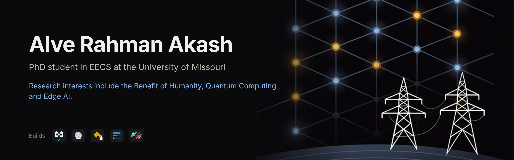
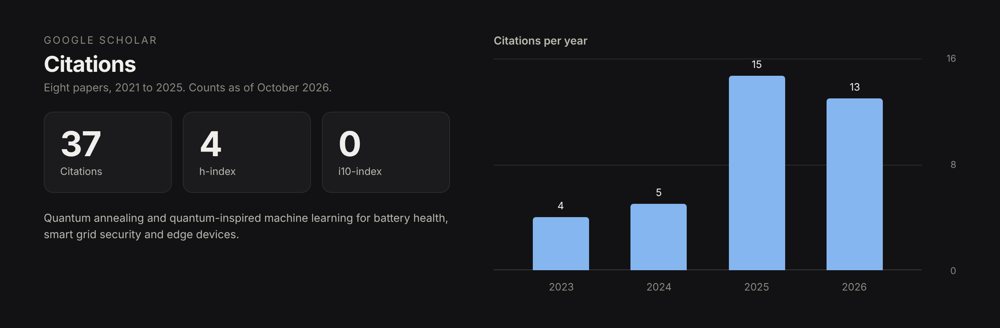

  

# Alve Rahman

I have been working with AI since 2020, but never got the time to create a git for myself, so here I am. The below thread here are some tooling for Claude Code and some fun apps, I built around one habit, since the inception of LLMs: verify what a chat model would otherwise just assert.

## What I build

| | Project | What it does |
|---|---|---|
|  | [research-hound](https://github.com/AlveeeRahman/research-hound) | A five-stage research workflow for Claude Code, from question to rubric score, with 21 scripts that verify citations, audit claims and lint manuscripts instead of trusting the model. |
|  | [skill-vision](https://github.com/AlveeeRahman/skill-vision) | A validator for Claude Agent Skills: spec conformance, script execution, quality and security scores, a Mermaid map of the skill, and the context tokens each skill costs. Zero dependencies. |
|  | [agent-oracle](https://github.com/AlveeeRahman/agent-oracle) | Decides how an agent system should be built before it runs: how many agents, which topology, what bounds the loop, what gets locked down before unattended work starts. Cites the papers it leans on. |
|  | [mr-usage](https://github.com/AlveeeRahman/mr-usage) | A Rust and Tauri desktop app that shows what is left on nine paid APIs in one window. Keys live in the OS keystore and never reach the UI. 109 tests on three operating systems. |
|  | [llm-dogfight](https://github.com/AlveeeRahman/llm-dogfight) | Two small local language models command rival saucer teams in your terminal. A 0.8 MB Rust binary, a Python sidecar on CUDA or Apple MLX, and a genetic algorithm that evolves each team's doctrine. |

NVIDIA SkillSpector scans the three skills on every push, and each ships with a `.skillspector-baseline.yaml` that names every suppressed finding and why.

## In the works

Two of my own, still in active development.

| | Project | What it does |
|---|---|---|
|  | [TigerOCR](https://tigerocr.buildforpeople.dev) | Hosted GPU OCR: send a PDF or image, get clean Markdown back with tables and formulas preserved. A remote MCP server and REST API, billed by the GPU second. In beta. |
|  | [Murasaki]| A purple-team platform for authorized security research: an LLM-driven reverse-engineering toolchain (Ghidra, radare2, binwalk, QEMU), malware detection (YARA and a malware-as-image CNN), and threat modeling mapped to CVSS and ATT&CK for ICS, behind one API or MCP endpoint and driven by an agent harness. Offense and its defense in one service, with power-grid / ICS research in mind. Built and tested, MIT and self-hostable on Azure; invite-only when hosted. |

## How I work with Claude

My Claude Code sessions run in the cloud with a short rulebook that Claude reads before anything else.

- Anything that touches the live web goes through agent-reach: SerpApi answers which pages rank, Firecrawl reads the page, and its developer, research and government indexes handle code, papers and law. The built-in search stays off unless I ask for it, because I want results I can audit.
- Every draft that leaves a session passes through humanizer, and anything that looks too confident gets hall-hunter, which has to name the file, line and contradicting fact for every finding or report it as unverified.
- Skills get validated by skill-vision before they ship. Agent designs start with agent-oracle's four questions. Papers go through research-hound, which checks that each DOI resolves and that its metadata matches the citation.
- The quantum-computing skill covers Qiskit, PennyLane, QuTiP and D-Wave Ocean, which is where the power systems work and the Claude work meet.

The icons on the five repositories above came out of one such sessions (Clearly I am no Photo Editor). Firecrawl read each project page, Higgsfield rendered the marks on the same near-black tile as the mr-usage app icon, Claude Design laid out the family, and Claude Code pushed the commits.

## Google Scholar

## Find me

[LinkedIn](https://www.linkedin.com/in/alvieee/) · [Google Scholar](https://scholar.google.com/citations?user=wRWUQQYAAAAJ)
